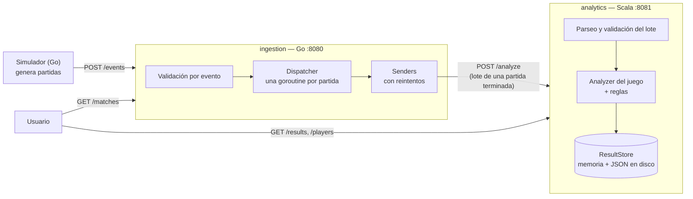

# GameStats

**Proyecto 1 — Lenguajes de Programación**
Instituto Tecnológico de Costa Rica, Sede San Carlos
Profesor: Oscar Viquez Acuña

| Integrante | Módulo |
|---|---|
| Danny Gonzalez Molina | Análisis de partidas (Scala) |
| Dylan Mendez Zamora | Ingestión de eventos (Go) |

---

## Qué es

GameStats es un sistema que recibe los eventos que generan partidas de videojuegos, los valida y calcula estadísticas y patrones de juego por partida y por jugador.

El sistema se divide en dos servicios que se comunican por HTTP con JSON:

- **Ingestión (Go)**: recibe los eventos uno a uno o en lote, valida cada uno, los agrupa por partida usando concurrencia y, cuando la partida termina, envía el lote completo al servicio de análisis.
- **Análisis (Scala)**: recibe el lote de una partida, calcula las estadísticas con un estilo funcional (funciones puras, inmutabilidad, `Option`/`Either`), detecta patrones y guarda el resultado.

Cada lenguaje se usa donde su paradigma aporta más: Go para manejar muchos eventos concurrentes con goroutines y canales, y Scala para transformar colecciones de eventos en estadísticas sin estado mutable.

## Arquitectura



1. Los eventos llegan a `POST /events` del servicio Go. Cada evento se valida por separado: uno inválido se rechaza (y se anota en un log) sin afectar a los demás.
2. Go agrupa los eventos por `matchId`. Cuando llega `MATCH_FINISHED`, ordena los eventos por `timestamp` y envía la partida completa a Scala. Si Scala no responde o responde `5xx`, reintenta 3 veces (1, 2 y 4 s).
3. Scala valida el lote, elige el analizador del juego (`racing` o `football`), calcula las estadísticas, aplica las reglas de patrones y guarda el resultado en memoria y en un archivo JSON por partida.
4. Los resultados se consultan en `GET /results` y `GET /players/{playerId}`.

### Estructura del repositorio

```
gamestats/
├── contracts/            contrato compartido: JSON Schemas y fixtures de prueba
├── ingestion-go/         servicio de ingestión (Go) + simulador
├── analytics-scala/      servicio de análisis (Scala)
├── docs/                 documentación adicional
├── docker-compose.yml    levanta el sistema completo
└── .github/workflows/    CI de cada módulo y CD
```

## Juegos y eventos

Se eligieron dos juegos con estructuras distintas, para comprobar que el sistema es genérico y no está pensado para un solo juego:

| | Racing (carreras) | Football (fútbol) |
|---|---|---|
| Competencia | Individual: cada jugador contra todos | Por equipos: dos equipos de varios jugadores |
| Qué se mide | Tiempos continuos (milisegundos por vuelta) y posiciones que cambian | Acciones discretas (pases, tiros, goles, faltas) y un marcador |
| Interacción entre jugadores | Indirecta (adelantamientos) | Directa (un pase tiene destinatario, un gol puede tener asistencia) |
| Cómo se decide el ganador | Orden de llegada (`ranking`) | Equipo con más goles; puede haber empate |

### Tipos de evento (comunes a todos los juegos)

`MATCH_STARTED`, `MATCH_FINISHED`, `PLAYER_JOINED`, `PLAYER_LEFT`, `PLAYER_DISCONNECTED`, `PLAYER_RECONNECTED` y `PLAYER_ACTION`. Describen el ciclo de vida de una partida y son iguales para cualquier juego. Lo específico de cada juego va dentro de `PLAYER_ACTION`, en los campos `action` y `data`.

### Acciones de cada juego

| Juego | Acción | Por qué existe |
|---|---|---|
| Racing | `LAP_COMPLETED` `{lap, lapTimeMs, position}` | Da los tiempos de vuelta (mejor vuelta, promedio, consistencia) y la posición en cada vuelta. |
| Racing | `POSITION_CHANGED` `{from, to, lap}` | Registra los adelantamientos entre vueltas; permite reconstruir la línea de tiempo de posiciones para detectar remontadas. |
| Racing | `PENALTY` `{seconds, reason}` | Un castigo cambia el tiempo efectivo y puede cambiar el ganador aunque el jugador haya sido el más rápido. |
| Football | `PASS` `{teamId, targetId, success, distance, minute}` | Mide la precisión de pase de cada jugador. |
| Football | `SHOT` `{teamId, onTarget, minute}` | Junto con `GOAL`, mide la efectividad de tiro. |
| Football | `GOAL` `{teamId, assistId?, minute}` | Construye el marcador y su evolución en el tiempo (remontadas), y registra asistencias. |
| Football | `FOUL` `{teamId, card, minute, targetId?}` | Faltas por equipo y tarjetas; con roja el jugador no genera más eventos. |

El formato completo de los eventos, del lote que Go envía a Scala y del resultado está en [`contracts/`](contracts/README.md), como JSON Schema y con ejemplos (fixtures) que usan las pruebas de los dos módulos.

### Agregar un juego nuevo

No obliga a reescribir el sistema:

- **Go**: agregar el juego y sus acciones al catálogo (`ingestion-go/internal/validation/catalog.go`).
- **Scala**: agregar el parseo de sus acciones (`Codecs.parseAction`), un analizador nuevo (`XAnalyzer`) con sus reglas, y registrarlo en `Analyzer.registry`. Las estadísticas genéricas (duración, eventos por acción, jugadores) funcionan sin cambios.

## Estadísticas y reglas

| | Racing | Football |
|---|---|---|
| **Por jugador** | Mejor vuelta, promedio por vuelta, consistencia (desviación estándar de las vueltas), segundos de penalización | Goles, asistencias, tiros, precisión de pase (exitosos / total) |
| **Por partida** | Duración, ganador (primero del `ranking`), eventos por acción | Duración, marcador final, ganador (`null` en empate), goles y faltas por equipo, eventos por acción |
| **Combina tipos de evento** | Tiempo efectivo = suma de vueltas (`LAP_COMPLETED`) + penalizaciones (`PENALTY`) | Efectividad de tiro = goles (`GOAL`) / tiros (`SHOT`) |
| **Regla por secuencia** | `COMEBACK`: el ganador estuvo en 3.er lugar o peor en algún momento | `COMEBACK`: el equipo ganador estuvo perdiendo en algún momento |
| **Regla adicional** | | `HAT_TRICK`: un jugador anota 3 goles o más |

Casos borde cubiertos: jugador sin tiros o sin pases (0.0, nunca se divide entre 0), empate (sin ganador y sin `COMEBACK`), equipo sin goles (aparece con 0 en el marcador) y gol sin asistencia.

## Cómo correrlo

### Opción 1: Docker (recomendada)

Requisitos: [Docker](https://www.docker.com/) con Docker Compose.

```bash
# 1. Construir y levantar los dos servicios (ingestion espera a que analytics esté listo)
docker compose up --build -d

# 2. Enviar partidas de prueba con el simulador
docker compose run --rm simulator

# 3. Ver los resultados
curl http://localhost:8081/results
curl http://localhost:8081/players/p1
curl http://localhost:8080/matches

# 4. Apagar (los resultados quedan en el volumen; con -v se borran)
docker compose down
```

El simulador genera siempre las mismas partidas para la misma semilla (`-seed 42` por defecto): 4 de racing, 4 de football y 5 escenarios fijos que prueban las reglas. Se pueden cambiar las opciones, por ejemplo:

```bash
docker compose run --rm simulator -target http://ingestion:8080 -racing 10 -football 10 -seed 7
```

| Escenario fijo (seed 42) | Qué prueba |
|---|---|
| `race-s42-comeback` | Remontada: p4 sale último y gana → `COMEBACK` |
| `race-s42-penalty` | p1 llega primero pero una penalización de 5 s le hace perder |
| `foot-s42-comeback` | B gana 1-0 y A da vuelta 2-1 → `COMEBACK`; tarjeta roja; gol sin asistencia |
| `foot-s42-draw` | Empate 1-1 → sin ganador; jugadores sin tiros |
| `foot-s42-hattrick` | p1 anota 3 goles → `HAT_TRICK` |

### Opción 2: sin Docker

Requisitos: JDK 21 y sbt 1.10 (Scala), Go 1.24 (ingestión).

```bash
# Terminal 1 — análisis (Scala), puerto 8081
cd analytics-scala
sbt run

# Terminal 2 — ingestión (Go), puerto 8080
cd ingestion-go
go run ./cmd/ingestion

# Terminal 3 — simulador
cd ingestion-go
go run ./cmd/simulator -target http://localhost:8080
```

En Windows (PowerShell) se usa `curl.exe` en lugar de `curl`.

### Variables de entorno

| Servicio | Variable | Por defecto | Qué hace |
|---|---|---|---|
| analytics | `PORT` | `8081` | Puerto HTTP |
| analytics | `RESULTS_DIR` | `./results` (`/data` en Docker) | Carpeta donde se guarda un JSON por partida |
| ingestion | `PORT` | `8080` | Puerto HTTP |
| ingestion | `SCALA_URL` | `http://localhost:8081` | Dirección del servicio de análisis |
| ingestion | `WORKERS` | `4` | Cuántos envíos a Scala en paralelo |
| ingestion | `IDLE_TIMEOUT` | `2m` | Inactividad tras la cual una partida se da por abandonada y no se envía a Scala *(en desarrollo)* |

## Endpoints

**Ingestión (Go, puerto 8080)**

| Método | Ruta | Qué hace |
|---|---|---|
| `GET` | `/health` | `{"status":"ok"}` |
| `POST` | `/events` | Recibe un evento (`{...}`) o varios (`[...]`); responde cuántos aceptó y el motivo de cada rechazo |
| `GET` | `/matches` | Estado de cada partida: `en_curso`, `terminada`, `enviada` o `error_envio` (`abandonada` cuando esté listo `IDLE_TIMEOUT`) |

**Análisis (Scala, puerto 8081)**

| Método | Ruta | Qué hace |
|---|---|---|
| `GET` | `/health` | `{"status":"ok"}` |
| `POST` | `/analyze` | Recibe el lote de una partida, lo analiza, lo guarda y responde el resultado. `400` si el lote es inválido |
| `GET` | `/results` | Todos los resultados guardados |
| `GET` | `/results/{matchId}` | El resultado de una partida (`404` si no existe) |
| `GET` | `/players/{playerId}` | Estadísticas de un jugador en todas sus partidas, de cualquier juego (`404` si no jugó) |

Quién valida qué (Go o Scala) y cuándo un lote se rechaza está detallado en [`contracts/README.md`](contracts/README.md#quién-valida-qué).

## Pruebas

```bash
# Scala: parseo, estadísticas, reglas, almacenamiento y endpoints
cd analytics-scala
sbt test

# Go: validación, pipeline, cliente, simulador
cd ingestion-go
go test ./...
```

Las pruebas de los dos módulos usan los mismos ejemplos de `contracts/fixtures/`, así que si el contrato cambia, ambos lo detectan.

## Integración continua y despliegue

| Workflow | Cuándo corre | Qué hace |
|---|---|---|
| `ci-go.yml` | Cambios en `ingestion-go/` o `contracts/` | `go vet`, `go test -race`, `go build`, `docker build` |
| `ci-scala.yml` | Cambios en `analytics-scala/` o `contracts/` | `sbt test`, `sbt assembly`, `docker build` |
| `cd.yml` | Pull requests hacia `main` y cada push a `main` | 1) **integración**: levanta el sistema con Docker Compose, corre el simulador y verifica que Scala haya guardado resultados; 2) **publicación** (solo en `main`): sube las imágenes a GitHub Container Registry; 3) **despliegue** (solo si la variable del repositorio `DEPLOY_ENABLED` es `true`) |

Las imágenes publicadas son:

```
ghcr.io/danny7w7-coder/gamestats-analytics:latest
ghcr.io/danny7w7-coder/gamestats-ingestion:latest
```

Cada una también se publica con el hash del commit como etiqueta. Como el repositorio es privado, para descargarlas hay que iniciar sesión primero (`docker login ghcr.io`).

## Documentación adicional

- [`contracts/README.md`](contracts/README.md): formato de eventos y resultados, fixtures y quién valida qué.
- [`docs/imperativo-vs-funcional.md`](docs/imperativo-vs-funcional.md): comparación entre el paradigma imperativo (Go) y el funcional (Scala) a partir de lo que se implementó.
