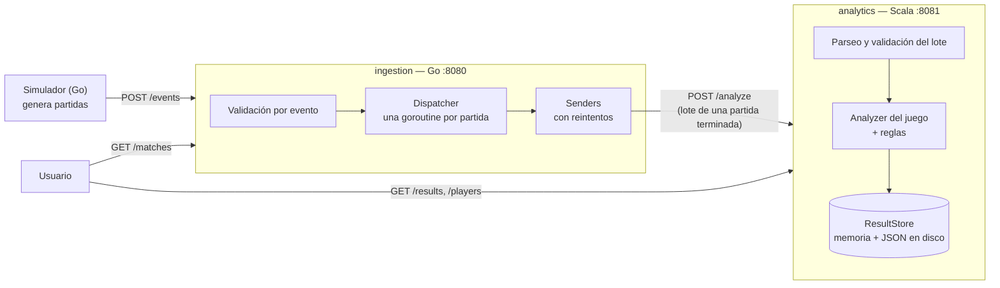

# GameStats

**Proyecto 1 — Lenguajes de Programación**
Instituto Tecnológico de Costa Rica, Sede San Carlos
Profesor: Oscar Viquez Acuña

| Integrante | Módulo |
|---|---|
| Danny Gonzalez Molina | Análisis de partidas (Scala) |
| Dylan Mendez Zamora | Ingestión de eventos (Go) |

---

## Qué es

GameStats es un sistema que recibe los eventos que generan partidas de videojuegos, los valida y calcula estadísticas y patrones de juego por partida y por jugador.

El sistema se divide en dos servicios que se comunican por HTTP con JSON:

- **Ingestión (Go)**: recibe los eventos uno a uno o en lote, valida cada uno, los agrupa por partida usando concurrencia y, cuando la partida termina, envía el lote completo al servicio de análisis.
- **Análisis (Scala)**: recibe el lote de una partida, calcula las estadísticas con un estilo funcional (funciones puras, inmutabilidad, `Option`/`Either`), detecta patrones y guarda el resultado.

Cada lenguaje se usa donde su paradigma aporta más: Go para manejar muchos eventos concurrentes con goroutines y canales, y Scala para transformar colecciones de eventos en estadísticas sin estado mutable.

## Arquitectura



1. Los eventos llegan a `POST /events` del servicio Go. Cada evento se valida por separado: uno inválido se rechaza (y se anota en un log) sin afectar a los demás.
2. Go agrupa los eventos por `matchId`. Cuando llega `MATCH_FINISHED`, ordena los eventos por `timestamp` y envía la partida completa a Scala. Si Scala no responde o responde `5xx`, reintenta 3 veces (1, 2 y 4 s).
3. Scala valida el lote en dos pasos: el formato de cada evento y su `data`, y después la coherencia con el resto de la partida (validaciones de contexto). Los eventos inválidos se descartan y quedan en el log. Luego elige el analizador del juego (`racing`, `football`, `fighting` o `tetris`), calcula las estadísticas, aplica las reglas de patrones y guarda el resultado en memoria y en un archivo JSON por partida.
4. Los resultados se consultan en `GET /results` y `GET /players/{playerId}`.

### Estructura del repositorio

```
gamestats/
├── contracts/            contrato compartido: JSON Schemas y fixtures de prueba
├── ingestion-go/         servicio de ingestión (Go) + simulador
├── analytics-scala/      servicio de análisis (Scala)
├── docs/                 documentación adicional
├── docker-compose.yml    levanta el sistema completo
└── .github/workflows/    CI de cada módulo y CD
```

## Juegos y eventos

GameStats analiza cuatro juegos con estructuras distintas, para comprobar que el sistema es genérico y no está pensado para un solo juego. Cada uno toma como referencia un videojuego conocido, en versión simple:

| | Racing (carreras) | Football (fútbol) | Fighting (peleas) | Tetris |
|---|---|---|---|---|
| Referencia | Mario Kart | Arcade retro 6 vs 6 (Nintendo World Cup, Super Sidekicks) | Mortal Kombat | Tetris clásico |
| Jugadores | Varios, cada uno contra todos | Dos equipos de hasta 6 (5 de campo y portero) | Dos (1 contra 1), por rounds | Uno solo |
| Qué se mide | Tiempos de vuelta, posiciones y objetos | Acciones discretas y un marcador | Daño, golpes y rounds | Puntaje, líneas y piezas |
| Interacción entre jugadores | Indirecta (adelantar, chocar, el aceite del otro) | Directa (pases, entradas, asistencias) | Directa (cada golpe tiene un objetivo) | Ninguna |
| Cómo se decide el ganador | Orden de llegada (`ranking`) | Equipo con más goles; puede haber empate | Quien gana más rounds; puede haber empate | No hay ganador (`null`): se juega contra uno mismo |

### Tipos de evento (comunes a todos los juegos)

`MATCH_STARTED`, `MATCH_FINISHED`, `MATCH_PAUSED`, `MATCH_RESUMED`, `PLAYER_JOINED`, `PLAYER_LEFT`, `PLAYER_DISCONNECTED`, `PLAYER_RECONNECTED` y `PLAYER_ACTION`. Describen el ciclo de vida de una partida y son iguales para cualquier juego; los de partida (`MATCH_*`) no llevan `playerId`. Lo específico de cada juego va dentro de `PLAYER_ACTION`, en los campos `action` y `data`.

### Acciones de cada juego

| Juego | Acciones | Para qué sirven |
|---|---|---|
| Racing (12) | `LAP_COMPLETED`, `POSITION_CHANGED`, `OVERTAKE`, `LAPPED` | Tiempos de vuelta, posiciones y su línea de tiempo (remontadas), adelantamientos y vueltas sacadas. |
| | `ITEM_PICKUP`, `ITEM_USED` | Objetos `boost` (nitro), `shield` (escudo) y `oil` (aceite). Cada jugador lleva uno a la vez. |
| | `DRIFT`, `COLLISION`, `SPIN`, `RESPAWN` | Derrapes, choques y trompos; `RESPAWN` es volver a la pista después de un choque o trompo. |
| | `PENALTY`, `DNF` | Segundos de castigo (cambian el tiempo efectivo y pueden cambiar el ganador) y abandono. |
| Football (11) | `PASS`, `DRIBBLE` | Precisión de pase y regates exitosos. |
| | `SHOT`, `POWER_SHOT`, `GOAL`, `OWN_GOAL` | Tiros normales y potentes, goles con asistencia opcional y autogoles (suman para el rival). Con ellos se arma el marcador y su evolución. |
| | `SAVE`, `TACKLE`, `INTERCEPTION` | Atajadas del portero y balones recuperados. |
| | `FOUL`, `CORNER` | Faltas con tarjeta (con roja el jugador queda fuera) y córners por equipo. |
| Fighting (10) | `ATTACK`, `SPECIAL_MOVE`, `COMBO`, `THROW` | Golpes (puño, patada, gancho), especiales, combos y agarres: daño hecho y precisión. |
| | `BLOCK`, `COMBO_BREAKER`, `KNOCKDOWN` | Defensa (bloquear, cortar el combo del rival) y derribos. |
| | `FATAL_BLOW`, `ROUND_WON`, `FATALITY` | Golpe fatal (una vez por pelea, solo con poca vida), ganador de cada round (KO o tiempo) y remate final del ganador. |
| Tetris (13) | `PIECE_SPAWNED`, `PIECE_MOVED`, `PIECE_ROTATED`, `SOFT_DROP`, `HARD_DROP`, `HOLD`, `PIECE_PLACED` | El recorrido de cada pieza: aparece, se mueve, gira, cae y queda fija. |
| | `LINES_CLEARED`, `T_SPIN`, `ALL_CLEAR` | Líneas limpiadas y puntos, giros especiales de la T y tablero vacío. |
| | `LEVEL_UP`, `STACK_HEIGHT`, `TOP_OUT` | Niveles, altura de la pila y fin de la partida. |

El formato exacto de cada evento (campos, rangos y valores permitidos), del lote que Go envía a Scala y del resultado está en [`contracts/`](contracts/README.md), como JSON Schema y con ejemplos (fixtures) que usan las pruebas de los dos módulos.

### Validación

Cada evento pasa por tres controles:

1. **Go**, al recibirlo: campos obligatorios, `timestamp` válido, tipo conocido y acción dentro del catálogo del juego.
2. **Scala, formato**: el `data` de cada acción tiene los campos, tipos, rangos y valores del schema (por ejemplo, `damage` entre 0 y 100, `item` uno de `boost`/`shield`/`oil`, un golpe fallado no hace daño).
3. **Scala, contexto**: el evento es coherente con lo que ya pasó en la partida. Hay 19 reglas, por ejemplo: no hay acciones durante una pausa; no se puede usar un objeto que no se agarró; nadie juega después de un `DNF`, una roja o un `TOP_OUT`; máximo 6 jugadores por equipo; solo el ganador de la pelea puede hacer la `FATALITY`; el nivel de tetris solo sube.

Un evento que falla se descarta (con su motivo en el log) y el resto de la partida se analiza igual; el lote completo solo se rechaza si el problema es del lote. Los fixtures `*_invalid_events.json` traen un evento inválido por cada regla, y las pruebas comprueban que se descarten exactamente esos. La lista completa de reglas está en [`contracts/README.md`](contracts/README.md#validaciones-de-contexto).

### Agregar un juego nuevo

No obliga a reescribir el sistema:

- **Go**: agregar el juego y sus acciones al catálogo (`ingestion-go/internal/validation/catalog.go`).
- **Scala**: agregar sus acciones al modelo (`model/Event.scala`) y su lectura con rangos (`Codecs.parseAction`); un analizador nuevo (`XAnalyzer`) con sus métricas y reglas; si tiene reglas de contexto, un `ContextCheck` propio (`validation/`); y registrarlo en `Analyzer.registry`. Las estadísticas genéricas (duración, eventos por acción, jugadores) y las validaciones comunes (pausa, referencias a otros jugadores) funcionan sin cambios.

## Estadísticas y reglas

| | Por jugador | Por partida | Patrones |
|---|---|---|---|
| **Racing** | Mejor vuelta, promedio, consistencia (desviación estándar de las vueltas), penalización, tiempo efectivo (vueltas + penalización), adelantamientos, objetos agarrados y usados, nitros, choques provocados | Duración, ganador (primero del `ranking`), eventos por acción | `COMEBACK`: el ganador estuvo 3.º o peor · `CLEAN_RACE`: el ganador no tuvo choques ni penalizaciones · `ITEM_MASTER`: alguien usó los tres objetos |
| **Football** | Goles, asistencias, tiros, efectividad de tiro (goles / tiros), tiros potentes, precisión de pase, atajadas, recuperaciones (entradas exitosas + intercepciones), regates exitosos | Duración, marcador (con autogoles), ganador (`null` en empate), goles, faltas y córners por equipo | `COMEBACK`: el equipo ganador estuvo perdiendo · `HAT_TRICK`: 3 goles o más de un jugador · `CLEAN_SHEET`: el ganador no recibió goles |
| **Fighting** | Daño hecho, precisión (golpes que conectaron / intentados), combo más largo, especiales, bloqueos, combos cortados, derribos, rounds ganados | Duración, ganador (más rounds; `null` en empate) | `COMEBACK`: perdió el primer round y ganó la pelea · `FLAWLESS_VICTORY`: ganó un round sin recibir daño · `FATALITY`: remató al rival |
| **Tetris** | Puntaje, líneas, tetris (4 líneas de una vez), piezas colocadas, piezas por minuto, nivel máximo, combo máximo, T-spins, hard drops | Duración, eventos por acción (sin ganador) | `BACK_TO_BACK`: dos tetris seguidos · `PERFECT_CLEAR`: tablero vacío · `T_SPIN_MASTER`: 3 T-spins o más |

Casos borde cubiertos: divisiones sin intentos (0.0, nunca se divide entre 0), empates (sin ganador y sin `COMEBACK`), equipo sin goles (aparece con 0), gol sin asistencia, autogol que da vuelta un partido, jugador sin eventos (métricas en 0) y partida sin `MATCH_FINISHED` (sin ganador).

## Cómo correrlo

### Opción 1: Docker (recomendada)

Requisitos: [Docker](https://www.docker.com/) con Docker Compose.

```bash
# 1. Construir y levantar los dos servicios (ingestion espera a que analytics esté listo)
docker compose up --build -d

# 2. Enviar partidas de prueba con el simulador
docker compose run --rm simulator

# 3. Ver los resultados
curl http://localhost:8081/results
curl http://localhost:8081/players/p1
curl http://localhost:8080/matches

# 4. Apagar (los resultados quedan en el volumen; con -v se borran)
docker compose down
```

El simulador genera siempre las mismas partidas para la misma semilla (`-seed 42` por defecto): 4 de racing, 4 de football y 5 escenarios fijos que prueban las reglas. Se pueden cambiar las opciones, por ejemplo:

```bash
docker compose run --rm simulator -target http://ingestion:8080 -racing 10 -football 10 -seed 7
```

| Escenario fijo (seed 42) | Qué prueba |
|---|---|
| `race-s42-comeback` | Remontada: p4 sale último y gana → `COMEBACK` |
| `race-s42-penalty` | p1 llega primero pero una penalización de 5 s le hace perder |
| `foot-s42-comeback` | B gana 1-0 y A da vuelta 2-1 → `COMEBACK`; tarjeta roja; gol sin asistencia |
| `foot-s42-draw` | Empate 1-1 → sin ganador; jugadores sin tiros |
| `foot-s42-hattrick` | p1 anota 3 goles → `HAT_TRICK` |

> El simulador todavía genera solo partidas de racing y football con las acciones originales. Las partidas de fighting y tetris, y las acciones nuevas de racing y football, se agregan con la actualización del módulo de Go. Mientras tanto, los fixtures de `contracts/fixtures/` se pueden enviar directo a Scala (`POST /analyze`), como se muestra en [`contracts/README.md`](contracts/README.md).

### Opción 2: sin Docker

Requisitos: JDK 21 y sbt 1.10 (Scala), Go 1.24 (ingestión).

```bash
# Terminal 1 — análisis (Scala), puerto 8081
cd analytics-scala
sbt run

# Terminal 2 — ingestión (Go), puerto 8080
cd ingestion-go
go run ./cmd/ingestion

# Terminal 3 — simulador
cd ingestion-go
go run ./cmd/simulator -target http://localhost:8080
```

En Windows (PowerShell) se usa `curl.exe` en lugar de `curl`.

### Variables de entorno

| Servicio | Variable | Por defecto | Qué hace |
|---|---|---|---|
| analytics | `PORT` | `8081` | Puerto HTTP |
| analytics | `RESULTS_DIR` | `./results` (`/data` en Docker) | Carpeta donde se guarda un JSON por partida |
| ingestion | `PORT` | `8080` | Puerto HTTP |
| ingestion | `SCALA_URL` | `http://localhost:8081` | Dirección del servicio de análisis |
| ingestion | `WORKERS` | `4` | Cuántos envíos a Scala en paralelo |
| ingestion | `IDLE_TIMEOUT` | `2m` | Inactividad tras la cual una partida se da por abandonada y no se envía a Scala |

## Endpoints

**Ingestión (Go, puerto 8080)**

| Método | Ruta | Qué hace |
|---|---|---|
| `GET` | `/health` | `{"status":"ok"}` |
| `POST` | `/events` | Recibe un evento (`{...}`) o varios (`[...]`); responde cuántos aceptó y el motivo de cada rechazo |
| `GET` | `/matches` | Estado de cada partida: `en_curso`, `terminada`, `enviada`, `error_envio` o `abandonada` (sin eventos durante `IDLE_TIMEOUT`) |

**Análisis (Scala, puerto 8081)**

| Método | Ruta | Qué hace |
|---|---|---|
| `GET` | `/health` | `{"status":"ok"}` |
| `POST` | `/analyze` | Recibe el lote de una partida, lo analiza, lo guarda y responde el resultado. `400` si el lote es inválido |
| `GET` | `/results` | Todos los resultados guardados |
| `GET` | `/results/{matchId}` | El resultado de una partida (`404` si no existe) |
| `GET` | `/players/{playerId}` | Estadísticas de un jugador en todas sus partidas, de cualquier juego (`404` si no jugó) |

Quién valida qué (Go o Scala) y cuándo un lote se rechaza está detallado en [`contracts/README.md`](contracts/README.md#quién-valida-qué).

## Pruebas

```bash
# Scala: parseo, validaciones de contexto, estadísticas y reglas de los 4 juegos, almacenamiento y endpoints
cd analytics-scala
sbt test

# Go: validación, pipeline, cliente, simulador
cd ingestion-go
go test ./...
```

Las pruebas de los dos módulos usan los mismos ejemplos de `contracts/fixtures/`, así que si el contrato cambia, ambos lo detectan. Hay una partida válida o más por juego, con escenarios que disparan cada patrón, y una partida inválida por juego donde cada evento `bad-*` rompe una regla distinta.

## Integración continua y despliegue

| Workflow | Cuándo corre | Qué hace |
|---|---|---|
| `ci-go.yml` | Cambios en `ingestion-go/` o `contracts/` | `go vet`, `go test -race`, `go build`, `docker build` |
| `ci-scala.yml` | Cambios en `analytics-scala/` o `contracts/` | `sbt test`, `sbt assembly`, `docker build` |
| `cd.yml` | Pull requests hacia `main` y cada push a `main` | 1) **integración**: levanta el sistema con Docker Compose, corre el simulador y verifica que Scala haya guardado resultados; 2) **publicación** (solo en `main`): sube las imágenes a GitHub Container Registry; 3) **despliegue** (solo si la variable del repositorio `DEPLOY_ENABLED` es `true`) |

Las imágenes publicadas son:

```
ghcr.io/danny7w7-coder/gamestats-analytics:latest
ghcr.io/danny7w7-coder/gamestats-ingestion:latest
```

Cada una también se publica con el hash del commit como etiqueta. Como el repositorio es privado, para descargarlas hay que iniciar sesión primero (`docker login ghcr.io`).

## Documentación adicional

- [`contracts/README.md`](contracts/README.md): formato de eventos y resultados, fixtures y quién valida qué.
- [`docs/ingestion-go.md`](docs/ingestion-go.md): detalle del módulo de ingestión (validación, concurrencia, simulador y cómo agregar un juego).
- [`docs/imperativo-vs-funcional.md`](docs/imperativo-vs-funcional.md): comparación entre el paradigma imperativo (Go) y el funcional (Scala) a partir de lo que se implementó.
