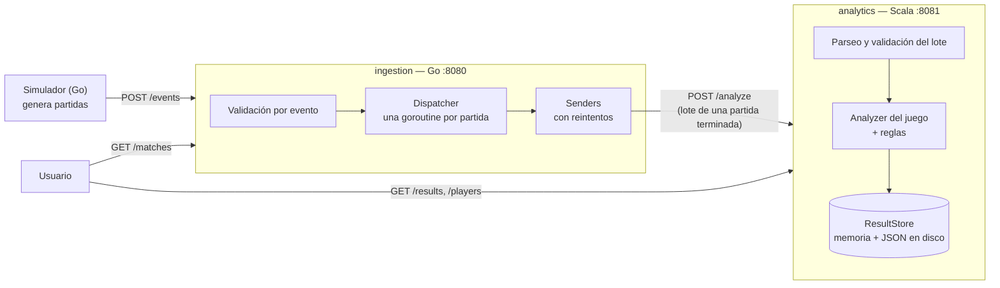

# GameStats

**Proyecto 1 — Lenguajes de Programación**
Instituto Tecnológico de Costa Rica, Sede San Carlos
Profesor: Oscar Viquez Acuña

| Integrante | Módulo |
|---|---|
| Danny Gonzalez Molina | Análisis de partidas (Scala) |
| Dylan Mendez Zamora | Ingestión de eventos (Go) |

---

## Contenido

1. [Qué es](#1-qué-es)
2. [Probarlo en 5 minutos](#2-probarlo-en-5-minutos)
3. [Arquitectura](#3-arquitectura)
4. [Juegos y eventos](#4-juegos-y-eventos)
5. [Validación y genericidad](#5-validación-y-genericidad)
6. [Estadísticas y reglas](#6-estadísticas-y-reglas)
7. [Datos de prueba: simulador y escenarios](#7-datos-de-prueba-simulador-y-escenarios)
8. [Otras formas de correrlo](#8-otras-formas-de-correrlo)
9. [Endpoints](#9-endpoints)
10. [Pruebas](#10-pruebas)
11. [CI/CD y deployment](#11-cicd-y-deployment)
12. [Documentación adicional](#12-documentación-adicional)

---

## 1. Qué es

GameStats es un sistema que recibe los eventos que generan partidas de videojuegos, los valida y calcula estadísticas y patrones de juego por partida y por jugador.

Se divide en dos servicios independientes que se comunican por HTTP con JSON:

- **Ingestión (Go)**: recibe los eventos uno a uno o en lote, valida cada uno, los agrupa por partida usando concurrencia y, cuando la partida termina, envía el lote completo al servicio de análisis.
- **Análisis (Scala)**: recibe el lote de una partida, calcula las estadísticas con un estilo funcional (funciones puras, inmutabilidad, `Option`/`Either`), detecta patrones y guarda el resultado.

Cada lenguaje se usa donde su paradigma aporta más: Go para manejar muchos eventos concurrentes con goroutines y canales, y Scala para transformar colecciones de eventos en estadísticas sin estado mutable.

---

## 2. Probarlo en 5 minutos

Esta es la versión desplegada (`v1.0`). Las imágenes ya construidas se descargan de GitHub Container Registry, así que:

- **Solo hace falta [Docker](https://www.docker.com/)** (en Windows y Mac, Docker Desktop abierto).
- No hace falta Java, sbt ni Go, no se compila nada y no se necesita ningún archivo del repositorio.
- Funciona en Windows, Linux y Mac (también con chip Apple).
- Los puertos 8080 y 8081 tienen que estar libres.

Los comandos se pegan en cualquier terminal (PowerShell, CMD o bash), desde cualquier carpeta.

### Paso 1: levantar los dos servicios

```bash
docker network create gamestats
docker run -d --name analytics --network gamestats -p 8081:8081 ghcr.io/danny7w7-coder/gamestats-analytics:v1.0
docker run -d --name ingestion --network gamestats -p 8080:8080 -e SCALA_URL=http://analytics:8081 ghcr.io/danny7w7-coder/gamestats-ingestion:v1.0
```

- La red `gamestats` permite que los dos contenedores se encuentren por nombre: Go le manda las partidas a `http://analytics:8081`.
- `analytics` es el servicio de Scala (puerto 8081) e `ingestion` el de Go (puerto 8080), cada uno en su propio contenedor.
- La primera vez se descargan las imágenes (unos 500 MB), y después arrancan en segundos.

### Paso 2: enviar partidas de prueba

```bash
docker run --rm --network gamestats --entrypoint /app/simulator ghcr.io/danny7w7-coder/gamestats-ingestion:v1.0 -target http://ingestion:8080
```

El simulador genera 30 partidas de los 4 juegos y se las manda a Go. En la terminal muestra, partida por partida, cuántos eventos envió, cuántos aceptó Go y el motivo de cada rechazo (un 3 % de los eventos se dañan a propósito). Al final dice `Total: 2481 aceptados, 57 rechazados`.

### Paso 3: ver los resultados

En el navegador:

| Dirección | Qué muestra |
|---|---|
| <http://localhost:8081/results> | Las 30 partidas analizadas por Scala |
| <http://localhost:8081/results/c4-s42-double> | Una partida: ganador, duración, eventos por acción, métricas de cada jugador y patrones (`DOUBLE_THREAT`, `QUICK_WIN`) |
| <http://localhost:8081/players/p1> | Un jugador en todas sus partidas, de cualquier juego |
| <http://localhost:8080/matches> | El estado de cada partida en Go |

### Paso 4: comprobar la conexión entre Go y Scala

1. **Go dice que la mandó**: `docker logs ingestion` muestra, para cada partida, `enviando c4-s42-double (22 eventos) a Scala` y después `c4-s42-double enviada a Scala`.
2. **Go la marca como enviada**: en <http://localhost:8080/matches> cada partida tiene `"status": "enviada"`, que Go solo pone cuando Scala confirma que recibió y guardó el lote.
3. **Scala la analizó completa**: el `eventCount` de una partida en `/matches` (Go) es igual al `totalEvents` de la misma partida en `/results/{matchId}` (Scala). Por ejemplo, `c4-s42-double` tiene 22 en los dos.

Los eventos que Scala descarta (si algún evento rompe una regla de la partida) aparecen con su motivo en `docker logs analytics`.

### Paso 5: apagar

```bash
docker rm -f analytics ingestion
docker network rm gamestats
```

Las imágenes quedan descargadas, así que la próxima vez arranca sin volver a bajarlas.

---

## 3. Arquitectura



1. Los eventos llegan a `POST /events` del servicio Go. Cada evento se valida por separado: uno inválido se rechaza (y se anota en un log) sin afectar a los demás.
2. Go agrupa los eventos por `matchId`. Cuando llega `MATCH_FINISHED`, ordena los eventos por `timestamp` y envía la partida completa a Scala. Si Scala no responde o responde `5xx`, reintenta 3 veces (1, 2 y 4 s).
3. Scala valida el lote en dos pasos: el formato de cada evento y su `data`, y después la coherencia con el resto de la partida (validaciones de contexto). Los eventos inválidos se descartan y quedan en el log. Luego elige el analizador del juego (`racing`, `fighting`, `connect4` o `tetris`), calcula las estadísticas, aplica las reglas de patrones y guarda el resultado en memoria y en un archivo JSON por partida.
4. Los resultados se consultan en `GET /results` y `GET /players/{playerId}`.

Se eligió HTTP entre los dos servicios porque cada envío devuelve una respuesta inmediata, con la que Go decide si la partida quedó enviada o si reintenta. La comparación con archivos compartidos o mensajería está en [`docs/imperativo-vs-funcional.md`](docs/imperativo-vs-funcional.md#por-qué-http-entre-go-y-scala).

### Estructura del repositorio

```
gamestats/
├── contracts/                 contrato compartido: JSON Schemas y fixtures de prueba
├── ingestion-go/              servicio de ingestión (Go) + simulador
├── analytics-scala/           servicio de análisis (Scala)
├── docs/                      documentación adicional
├── docker-compose.yml         levanta el sistema compilando el código
├── docker-compose.deploy.yml  levanta la versión publicada (sin compilar)
└── .github/workflows/         CI de cada módulo y CD
```

---

## 4. Juegos y eventos

GameStats analiza cuatro juegos con estructuras distintas, para comprobar que el sistema es genérico y no está pensado para un solo juego. Cada uno toma como referencia un videojuego conocido, en versión simple, de forma que también se pueda programar de verdad más adelante:

| | Racing (carreras) | Fighting (peleas) | Connect4 (4 en línea) | Tetris |
|---|---|---|---|---|
| Referencia | Carrera arcade por posiciones | Street Fighter / Mortal Kombat básico | Connect Four | Tetris clásico |
| Jugadores | Varios, cada uno contra todos | Dos (1 contra 1), por rounds | Dos, por turnos; uno puede ser la IA | Uno solo |
| Tiempo | Continuo (vueltas) | Continuo, dividido en rounds | Por turnos | Continuo (pieza a pieza) |
| Qué se mide | Tiempos de vuelta y posiciones | Daño, golpes y rounds | Fichas, amenazas y bloqueos | Puntaje, líneas y piezas |
| Interacción entre jugadores | Indirecta (adelantar, chocar) | Directa (cada golpe tiene un objetivo) | Directa (tapar la jugada del rival) | Ninguna |
| Cómo se decide el ganador | Orden de llegada (`ranking`) | Quien gana más rounds; puede haber empate | Quien hace 4 en línea; tablero lleno = empate | No hay ganador (`null`): se juega contra uno mismo |

### Tipos de evento (comunes a todos los juegos)

`MATCH_STARTED`, `MATCH_FINISHED`, `MATCH_PAUSED`, `MATCH_RESUMED`, `PLAYER_JOINED`, `PLAYER_LEFT`, `PLAYER_DISCONNECTED`, `PLAYER_RECONNECTED` y `PLAYER_ACTION`. Describen el ciclo de vida de una partida y son iguales para cualquier juego; los de partida (`MATCH_*`) no llevan `playerId`. Lo específico de cada juego va dentro de `PLAYER_ACTION`, en los campos `action` y `data`.

Todo evento lleva `eventId`, `timestamp`, `gameId`, `gameVersion` y `matchId`: así se relaciona cada evento con su juego, su partida y, cuando corresponde, su jugador (`playerId`).

### Acciones de cada juego

| Juego | Acciones | Para qué sirven |
|---|---|---|
| Racing (8) | `LAP_COMPLETED`, `POSITION_CHANGED`, `OVERTAKE`, `LAPPED` | Tiempos de vuelta, posiciones y su línea de tiempo (remontadas, liderar toda la carrera), adelantamientos y vueltas sacadas. |
| | `COLLISION`, `RESPAWN` | Choques entre dos autos; `RESPAWN` es volver a la pista después de un choque. |
| | `PENALTY`, `DNF` | Segundos de castigo (cambian el tiempo efectivo y pueden cambiar el ganador) y abandono. |
| Fighting (6) | `ATTACK`, `COMBO` | Golpes sueltos (puño o patada, pueden fallar) y combos: daño hecho y precisión. |
| | `BLOCK`, `KNOCKDOWN` | Defensa y derribos. |
| | `ROUND_WON`, `ROUND_DRAW` | Resultado de cada round: ganado (por KO o por tiempo) o empatado (doble KO, o tiempo con la misma vida). |
| Connect4 (7) | `DISC_DROPPED` | Cada ficha que se suelta (columna y fila): con ellas se reconstruye el tablero. |
| | `THREAT_CREATED`, `THREAT_BLOCKED`, `CONNECT_FOUR` | Amenazas (3 en línea con la cuarta casilla libre), amenazas tapadas por el rival y el 4 en línea que gana. |
| | `TURN_TIMEOUT`, `UNDO`, `HINT_USED` | Turno perdido por tiempo, deshacer una jugada (solo contra la IA) y pedir una pista. |
| Tetris (13) | `PIECE_SPAWNED`, `PIECE_MOVED`, `PIECE_ROTATED`, `SOFT_DROP`, `HARD_DROP`, `HOLD`, `PIECE_PLACED` | El recorrido de cada pieza: aparece, se mueve, gira, cae y queda fija. |
| | `LINES_CLEARED`, `T_SPIN`, `ALL_CLEAR` | Líneas limpiadas y puntos, giros especiales de la T y tablero vacío. |
| | `LEVEL_UP`, `STACK_HEIGHT`, `TOP_OUT` | Niveles, altura de la pila y fin de la partida. |

### Por qué estos eventos

Cada acción está porque alimenta una estadística o un patrón, o porque el juego real la necesita para contar lo que pasó. El catálogo cubre todo lo que mandaría cada juego si se programara (por ejemplo, para una interfaz en el proyecto 2), así que no hace falta agregar eventos después.

- **Racing**: una carrera se entiende por vueltas y posiciones. `LAP_COMPLETED` y `POSITION_CHANGED` permiten reconstruir la línea de tiempo de cada piloto (de ahí salen `COMEBACK` y `WIRE_TO_WIRE`), y `PENALTY` cambia el tiempo efectivo. Los objetos, trompos y derrapes se sacaron: complicaban el juego sin aportar estadísticas que no salieran ya de choques y posiciones.
- **Fighting**: lo mínimo que tiene cualquier juego de pelea: golpes que pueden fallar (precisión), combos (técnica), bloqueos, derribos y el resultado de cada round. `ROUND_DRAW` existe porque en un juego real puede haber doble KO o terminar el tiempo con la misma vida, y sin él no habría forma de registrarlo. Los especiales, agarres y la *fatality* se sacaron para dejar un juego básico.
- **Connect4**: es el único juego por turnos. `DISC_DROPPED` con columna y fila basta para reconstruir el tablero; `THREAT_CREATED` y `THREAT_BLOCKED` registran la parte estratégica (atacar y defender), y `CONNECT_FOUR` el final. `TURN_TIMEOUT`, `UNDO` y `HINT_USED` son funciones habituales de una versión jugable (tiempo por turno, deshacer y pistas contra la IA).
- **Tetris**: el recorrido completo de cada pieza y lo que se consigue con ella (líneas, T-spins, tablero vacío), además del nivel y la altura de la pila.

El formato exacto de cada evento (campos, rangos y valores permitidos), del lote que Go envía a Scala y del resultado está en [`contracts/`](contracts/README.md), como JSON Schema y con ejemplos (fixtures) que usan las pruebas de los dos módulos. Con eso, un sistema externo puede producir eventos sin conocer cómo está hecho GameStats por dentro.

---

## 5. Validación y genericidad

### Los tres controles de cada evento

1. **Go**, al recibirlo: campos obligatorios, `timestamp` válido, juego y tipo conocidos, y que la acción no sea de otro juego. Una acción que no existe en ningún juego se acepta con un aviso (puede ser un evento nuevo).
2. **Scala, formato**: el `data` de cada acción tiene los campos, tipos, rangos y valores del schema (por ejemplo, `damage` entre 0 y 100, `column` entre 1 y 7, un golpe fallado no hace daño).
3. **Scala, contexto**: el evento es coherente con lo que ya pasó en la partida. Hay 20 reglas, por ejemplo: no hay acciones durante una pausa; nadie juega después de un `DNF` o un `TOP_OUT`; `RESPAWN` solo después de un choque; un round tiene un solo resultado; en 4 en línea se juega por turnos, la ficha cae a la primera fila libre y solo se tapa una amenaza que existe; el nivel de tetris solo sube.

Un evento que falla se descarta (con su motivo en el log) y el resto de la partida se analiza igual; el lote completo solo se rechaza si el problema es del lote. Los fixtures `*_invalid_events.json` traen un evento inválido por cada regla, y las pruebas comprueban que se descarten exactamente esos. La lista completa de reglas y quién valida qué está en [`contracts/README.md`](contracts/README.md#validaciones-de-contexto).

### Agregar eventos o juegos

Una **acción nueva** de un juego que ya existe no necesita cambios: Go la acepta con un aviso y Scala la guarda como `UnknownAction`, la cuenta en `eventsByAction` y analiza el resto de la partida igual. Por eso una partida con una acción que salió del contrato (por ejemplo `ITEM_PICKUP`, de cuando racing tenía objetos) se sigue leyendo sin error.

Un **juego nuevo** tampoco obliga a reescribir el sistema:

- **Go**: agregar el juego y sus acciones al catálogo (`ingestion-go/internal/validation/catalog.go`).
- **Scala**: agregar sus acciones al modelo (`model/Event.scala`) y su lectura con rangos (`Codecs.parseAction`); un analizador nuevo (`XAnalyzer`) con sus métricas y reglas; si tiene reglas de contexto, un `ContextCheck` propio (`validation/`); y registrarlo en `Analyzer.registry`. Las estadísticas genéricas (duración, eventos por acción, jugadores) y las validaciones comunes (pausa, referencias a otros jugadores) funcionan sin cambios.

---

## 6. Estadísticas y reglas

| | Por jugador | Por partida | Patrones |
|---|---|---|---|
| **Racing** | Mejor vuelta, promedio, consistencia (desviación estándar de las vueltas), penalización, tiempo efectivo (vueltas + penalización), adelantamientos, choques provocados, vueltas lideradas | Duración, ganador (primero del `ranking`), eventos por acción | `COMEBACK`: el ganador estuvo 3.º o peor · `CLEAN_RACE`: el ganador no tuvo choques ni penalizaciones · `WIRE_TO_WIRE`: el ganador fue 1.º toda la carrera |
| **Fighting** | Daño hecho, precisión (golpes que conectaron / intentados), combo más largo, bloqueos, derribos, rounds ganados | Duración, ganador (más rounds; `null` en empate) | `COMEBACK`: perdió el primer round y ganó la pelea · `FLAWLESS_VICTORY`: ganó un round sin recibir daño · `COMBO_MASTER`: combo de 5 golpes o más |
| **Connect4** | Fichas, amenazas creadas, amenazas tapadas, control del centro (proporción de fichas en la columna 4), pistas, deshacer, turnos perdidos | Duración, ganador (quien hace 4 en línea; `null` en empate) | `DOUBLE_THREAT`: dos amenazas abiertas a la vez · `QUICK_WIN`: ganó con 7 fichas o menos · `PERFECT_DEFENSE`: tapó todas las amenazas del rival (al menos 2) |
| **Tetris** | Puntaje, líneas, tetris (4 líneas de una vez), piezas colocadas, piezas por minuto, nivel máximo, combo máximo, T-spins, hard drops | Duración, eventos por acción (sin ganador) | `BACK_TO_BACK`: dos tetris seguidos · `PERFECT_CLEAR`: tablero vacío · `T_SPIN_MASTER`: 3 T-spins o más |

- **Estadística por jugador en todas sus partidas**: `/players/{playerId}` junta las métricas y los patrones de un jugador en cualquier juego.
- **Estadísticas que combinan tipos de eventos**: el tiempo efectivo (vueltas + penalizaciones), `CLEAN_RACE` (choques + penalizaciones) y las amenazas tapadas (amenazas + fichas).
- **Patrones por secuencia**: todas las reglas recorren los eventos en orden. Por ejemplo, `COMEBACK` sigue la línea de tiempo de posiciones del ganador y `BACK_TO_BACK` mira limpiezas de líneas consecutivas.
- En connect4, las reglas de contexto y los patrones trabajan sobre el tablero reconstruido evento a evento: el estado de la validación es el tablero, y `UNDO` simplemente vuelve al tablero anterior (los tableros son inmutables, así que basta con guardarlos en una pila).

Casos borde cubiertos: divisiones sin intentos (0.0, nunca se divide entre 0), empates (sin ganador y sin `COMEBACK`), rounds empatados que no suman para nadie, tablero lleno sin ganador, fichas deshechas que no cuentan para `QUICK_WIN`, jugador sin eventos (métricas en 0) y partida sin `MATCH_FINISHED` (sin ganador).

---

## 7. Datos de prueba: simulador y escenarios

No se implementan los videojuegos: el simulador (`ingestion-go/cmd/simulator`) hace de fuente externa. Genera siempre las mismas partidas para la misma semilla (`-seed 42` por defecto): **4 partidas al azar de cada juego y 14 escenarios fijos** que prueban los patrones, 30 partidas en total. Cada partida se envía en su propia goroutine, así que los eventos de distintas partidas y juegos llegan mezclados, como si se jugaran en paralelo. Además daña un 3 % de los eventos a propósito, para mostrar que Go los rechaza.

| Escenario fijo (seed 42) | Qué pasa | Patrones |
|---|---|---|
| `race-s42-comeback` | p4 sale último y gana | `COMEBACK`, `CLEAN_RACE` |
| `race-s42-penalty` | p1 es el más rápido en pista, pero una penalización de 5 s le hace perder | `CLEAN_RACE` (de p2) |
| `race-s42-clean` | p1 gana sin choques ni penalizaciones; los demás sí los tienen | `CLEAN_RACE`, `WIRE_TO_WIRE` |
| `race-s42-wire` | p1 termina primero todas las vueltas, sin ningún cambio de posición | `CLEAN_RACE`, `WIRE_TO_WIRE` |
| `race-s42-dnf` | p3 choca contra p1 y abandona (`DNF`); p1, el chocado, vuelve a la pista; la carrera se pausa; p2 gana desde el 3.er lugar | `COMEBACK`, `CLEAN_RACE` |
| `fight-s42-flawless` | p1 gana el round 1 sin recibir daño y la pelea 2-0 | `FLAWLESS_VICTORY` |
| `fight-s42-comeback` | p1 gana el round 1 por tiempo y p2 gana los rounds 2 y 3, con una pausa | `COMEBACK` |
| `fight-s42-combo` | Round 1 en doble KO (`ROUND_DRAW`), un combo de 6 golpes y p1 gana 2-0; usa las 6 acciones | `COMBO_MASTER` |
| `c4-s42-quick` | p1 gana con 4 fichas (vertical) | `QUICK_WIN` |
| `c4-s42-double` | p1 contra la IA: deshace una mala jugada (`UNDO`), pide una pista y arma dos amenazas a la vez | `DOUBLE_THREAT`, `QUICK_WIN` |
| `c4-s42-defense` | p2 tapa las dos amenazas de p1; p1 pierde un turno por tiempo y p2 gana | `QUICK_WIN`, `PERFECT_DEFENSE` |
| `c4-s42-draw` | El tablero se llena (42 fichas) sin 4 en línea: empate | `DOUBLE_THREAT` y `PERFECT_DEFENSE` de los dos (en 42 fichas ambos arman y tapan amenazas) |
| `tetris-s42-b2b` | Dos tetris seguidos (con `HOLD`) y subida al nivel 2 | `BACK_TO_BACK` |
| `tetris-s42-perfect` | 3 T-spins y un tetris que deja el tablero vacío, con pausa | `PERFECT_CLEAR`, `T_SPIN_MASTER` |

Cada escenario se puede ver en `http://localhost:8081/results/<escenario>`. Se pueden cambiar las opciones del simulador agregándolas al final del comando, por ejemplo:

```bash
docker run --rm --network gamestats --entrypoint /app/simulator ghcr.io/danny7w7-coder/gamestats-ingestion:v1.0 -target http://ingestion:8080 -racing 10 -fighting 10 -connect4 10 -tetris 10 -seed 7
```

El detalle del simulador está en [`docs/ingestion-go.md`](docs/ingestion-go.md).

---

## 8. Otras formas de correrlo

### Con Docker Compose y las imágenes publicadas

Lo mismo que la [sección 2](#2-probarlo-en-5-minutos), pero con el archivo [`docker-compose.deploy.yml`](docker-compose.deploy.yml), que además espera a que cada servicio esté listo antes de arrancar el siguiente. Se corre desde la carpeta del repositorio:

```bash
docker compose -f docker-compose.deploy.yml up -d --wait
docker compose -f docker-compose.deploy.yml run --rm simulator
docker compose -f docker-compose.deploy.yml down
```

Para usar otra versión publicada: `GAMESTATS_TAG=<tag> docker compose -f docker-compose.deploy.yml up -d --wait` (en PowerShell: `$env:GAMESTATS_TAG="<tag>"` antes del comando).

### Con Docker Compose, compilando el código

Construye las dos imágenes desde el código del repositorio (la primera vez tarda varios minutos, sobre todo Scala). Es la forma que se usa al desarrollar y la que prueba el CI:

```bash
docker compose up --build -d --wait     # construye y levanta analytics e ingestion
docker compose run --rm simulator       # envía las partidas de prueba
docker compose down                     # apaga (con -v también borra los resultados guardados)
```

### Sin Docker

Requisitos: JDK 21 y sbt 1.10 (Scala), Go 1.24 (ingestión). Una terminal por servicio:

```bash
# Terminal 1 — análisis (Scala), puerto 8081
cd analytics-scala
sbt run

# Terminal 2 — ingestión (Go), puerto 8080
cd ingestion-go
go run ./cmd/ingestion

# Terminal 3 — simulador
cd ingestion-go
go run ./cmd/simulator -target http://localhost:8080
```

### Sin internet

Con las imágenes ya descargadas una vez, se pueden guardar en un archivo y volver a cargar sin conexión. `docker save` guarda solo la arquitectura de la máquina donde se corre (amd64 o arm64), así que el archivo sirve en esa misma máquina o en otra de la misma arquitectura:

```bash
docker save -o gamestats.tar ghcr.io/danny7w7-coder/gamestats-analytics:v1.0 ghcr.io/danny7w7-coder/gamestats-ingestion:v1.0
docker load -i gamestats.tar
```

### Variables de entorno

| Servicio | Variable | Por defecto | Qué hace |
|---|---|---|---|
| analytics | `PORT` | `8081` | Puerto HTTP |
| analytics | `RESULTS_DIR` | `./results` (`/data` en Docker) | Carpeta donde se guarda un JSON por partida |
| ingestion | `PORT` | `8080` | Puerto HTTP |
| ingestion | `SCALA_URL` | `http://localhost:8081` | Dirección del servicio de análisis |
| ingestion | `WORKERS` | `4` | Cuántos envíos a Scala en paralelo |
| ingestion | `IDLE_TIMEOUT` | `2m` | Inactividad tras la cual una partida se da por abandonada y no se envía a Scala |

---

## 9. Endpoints

En Windows (PowerShell) se puede usar `curl.exe` en lugar de `curl`, o abrir las direcciones `GET` en el navegador.

**Ingestión (Go, puerto 8080)**

| Método | Ruta | Qué hace |
|---|---|---|
| `GET` | `/health` | `{"status":"ok"}` |
| `POST` | `/events` | Recibe un evento (`{...}`) o varios (`[...]`); responde cuántos aceptó y el motivo de cada rechazo |
| `GET` | `/matches` | Estado de cada partida: `en_curso`, `terminada`, `enviada`, `error_envio` o `abandonada` (sin eventos durante `IDLE_TIMEOUT`) |

**Análisis (Scala, puerto 8081)**

| Método | Ruta | Qué hace |
|---|---|---|
| `GET` | `/health` | `{"status":"ok"}` |
| `POST` | `/analyze` | Recibe el lote de una partida, lo analiza, lo guarda y responde el resultado. `400` si el lote es inválido |
| `GET` | `/results` | Todos los resultados guardados |
| `GET` | `/results/{matchId}` | El resultado de una partida (`404` si no existe) |
| `GET` | `/players/{playerId}` | Estadísticas de un jugador en todas sus partidas, de cualquier juego (`404` si no jugó) |

Quién valida qué (Go o Scala) y cuándo un lote se rechaza está detallado en [`contracts/README.md`](contracts/README.md#quién-valida-qué).

---

## 10. Pruebas

```bash
# Scala: parseo, validaciones de contexto, estadísticas y reglas de los 4 juegos, almacenamiento y endpoints
cd analytics-scala
sbt test

# Go: validación, pipeline, cliente, simulador
cd ingestion-go
go test ./...
```

Las pruebas son de tres niveles:

1. **Unitarias de cada módulo**: Scala (117 tests) y Go (`go test -race`, que también detecta problemas de concurrencia).
2. **Fixtures compartidos** (`contracts/fixtures/`): los usan los dos módulos, así que si el contrato cambia, ambos lo detectan. Hay una partida válida o más por juego, con escenarios que disparan cada patrón, y una partida inválida por juego donde cada evento `bad-*` rompe una regla distinta.
3. **De punta a punta**: el CD levanta el sistema completo, corre el simulador y verifica que lleguen las 30 partidas a Scala pasando por Go (ver la [sección 11](#11-cicd-y-deployment)).

---

## 11. CI/CD y deployment

| Workflow | Cuándo corre | Qué hace |
|---|---|---|
| `ci-go.yml` | Cambios en `ingestion-go/` o `contracts/` | `go vet`, `go test -race`, `go build`, `docker build` |
| `ci-scala.yml` | Cambios en `analytics-scala/` o `contracts/` | `sbt test`, `sbt assembly`, `docker build` |
| `cd.yml` | Pull requests hacia `main`, cada push a `main` y cada tag de versión (`v*`) | 1) **integración**: levanta el sistema con Docker Compose (compilando), corre el simulador y verifica las 30 partidas; 2) **publicación** (no en PRs): construye las dos imágenes para amd64 y arm64 y las sube a GitHub Container Registry; 3) **deployment** (no en PRs): levanta el sistema con `docker-compose.deploy.yml` usando las imágenes **descargadas** de GHCR, corre el simulador y verifica las 30 partidas |

### Deployment

Cada versión de GameStats se publica como dos imágenes en GitHub Container Registry, y se ejecuta en cualquier computadora que tenga Docker, por ejemplo la del profesor, sin compilar ni instalar nada más ([sección 2](#2-probarlo-en-5-minutos)). Ese es el entorno de ejecución que elegimos: no mantenemos un servidor encendido con una dirección pública.

El CD construye, prueba y publica cada versión, y el job `deploy` comprueba que lo publicado funciona tal como lo va a usar quien lo reciba: en una máquina limpia (el runner de GitHub Actions), baja las imágenes del registro, levanta el sistema, corre el simulador y verifica las 30 partidas. Al terminar la verificación el sistema se apaga.

Las imágenes publicadas son:

```
ghcr.io/danny7w7-coder/gamestats-analytics:<tag>
ghcr.io/danny7w7-coder/gamestats-ingestion:<tag>
```

con estos tags: el hash de cada commit, `latest` (lo último de `main`) y el nombre de cada versión. Una versión es fija: aunque después haya cambios en `main`, `v1.0` siempre es la misma.

Para publicar una versión nueva:

```bash
git tag v1.1
git push origin v1.1
```

Eso dispara el CD con los tres jobs y publica las imágenes con ese nombre. La versión de la entrega es `v1.0`.

---

## 12. Documentación adicional

- [`contracts/README.md`](contracts/README.md): formato de eventos y resultados, validaciones de contexto, fixtures y quién valida qué.
- [`docs/ingestion-go.md`](docs/ingestion-go.md): detalle del módulo de ingestión (validación, concurrencia, simulador y cómo agregar un juego).
- [`docs/imperativo-vs-funcional.md`](docs/imperativo-vs-funcional.md): comparación entre el paradigma imperativo (Go) y el funcional (Scala) a partir de lo que se implementó, y por qué HTTP entre los dos módulos.
